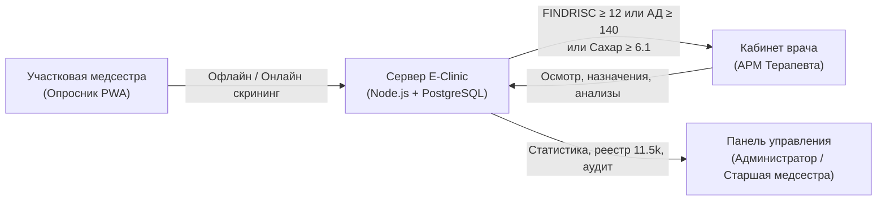
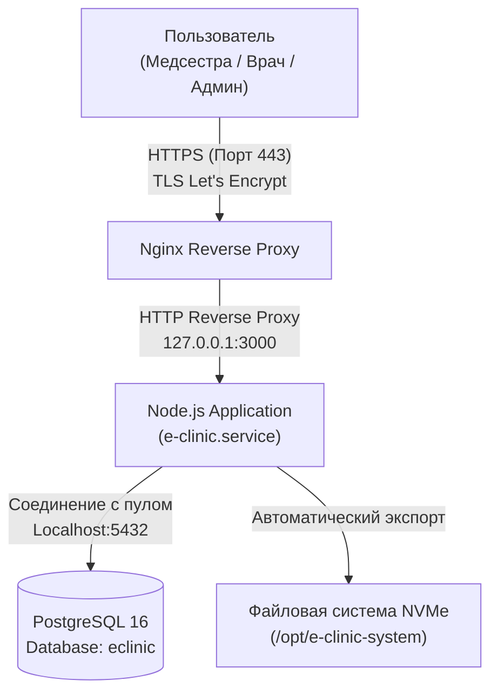

# Отчёт о текущем состоянии проекта «E-Clinic»
**Дата формирования отчёта:** 8 ноября 2026 г.  
**Версия системы:** `2.4.0` (Service Worker `medical-mobile-v92`)  
**Окружение:** Продакшн (AWS Lightsail, Стокгольм, Ubuntu 24.04 LTS, PostgreSQL 16)  
**Основной домен:** `https://admin.e-clinic-control.ru`

---

## 1. Обзор системы и назначение

**E-Clinic (Medical QR System)** — специализированная медицинская веб-платформа и PWA для первичного скрининга, стратификации рисков и диспансерного учёта пациентов с подозрением или подтверждённым диагнозом сахарного диабета 2-го типа (СД2) и сердечно-сосудистых заболеваний (ССЗ) в амбулаторных поликлиниках.

### Ключевые цели платформы:
- Массовый скрининг взрослого населения силами участковых медсестёр на смартфонах и планшетах (в том числе при полном отсутствии интернета).
- Автоматический расчёт клинических шкал риска в реальном времени:
  - **FINDRISC** (шкала риска развития диабета на ближайшие 10 лет).
  - **SCORE2 / SCORE2-OP Lite** (шкала 10-летнего риска сердечно-сосудистых событий).
  - **Формула Рабито** (расчёт идеальной/расчётной массы тела при отсутствии медицинских весов).
- Автоматическая маршрутизация пациентов с высоким риском в кабинет терапевта/эндокринолога.
- Диспансерный учёт, повторные визиты, лабораторные профили (глюкоза, HbA1c, липидограмма, креатинин, СКФ) и задачи контроля.
- Управленческий мониторинг: дашборды для главных врачей, старших медсестёр поликлиник и координаторов проекта.

---

## 2. Архитектура и стек технологий

| Компонент | Технология / Стек | Назначение |
| :--- | :--- | :--- |
| **Backend** | Node.js (Vanilla ES Modules, без тяжелых фреймворков) | Высокопроизводительный сервер API, низкое потребление RAM (~35-65 МБ), генерация PDF/Excel/PPTX. |
| **База данных** | PostgreSQL 16 (с резервным fallback на JSON file-db) | Хранение 17 таблиц сущностей с JSONB-полями для быстрых выборок и миграций. |
| **Frontend** | Vanilla JS (ES Modules) + Responsive CSS | PWA, не требующий сборки Webpack/Vite. Быстрая загрузка на бюджетных смартфонах медицинского персонала. |
| **Офлайн-движок** | Service Worker (`medical-mobile-v92`) + IndexedDB (`eclinic_offline_v2`) | Полный сбор анкет в полевых условиях без связи, Background Sync, конфликт-резолюшн. |
| **Хостинг** | AWS Lightsail (2 vCPU, 2 GB RAM, 60 GB NVMe SSD) | Размещение бэкенда, СУБД, Nginx reverse proxy с Let's Encrypt SSL. |
| **Мониторинг** | Systemd (`e-clinic.service`) + Health Endpoint (`/api/health`) | Автоперезапуск, логирование, zero-downtime перезагрузка. |

---

## 3. Текущие живые метрики боевого сервера (8 ноября 2026 г.)

По состоянию на 8 ноября 2026 г. с боевой СУБД PostgreSQL получены следующие показатели:

| Метрика | Значение | Примечание |
| :--- | :--- | :--- |
| **Всего скрининговых анкет медсестёр** | **11 502** | Общее количество обследованных пациентов |
| **Подключенных поликлиник** | **15** | Городские поликлиники проекта |
| **Зарегистрированных врачей** | **45** | Участковые терапевты и узкие специалисты |
| **Проведено врачебных приёмов** | **137** | Карточки углубленного осмотра и назначений |
| **Записей журнала аудита действий** | **5 227** | Полная трассировка логинов, изменений и экспортов |
| **Статус службы e-clinic** | **Active (running)** | Uptime сервера: 9+ дней, Load average: `0.00, 0.02, 0.00` |
| **Потребление оперативной памяти** | **836 МБ из 1.9 ГБ** | ~1 ГБ свободной RAM, стабильный запас ресурсов |

### Распределение пациентов по поликлиникам (Топ-10):
1. **Поликлиника №10** — 2 564 анкеты
2. **Поликлиника №14** — 2 105 анкет
3. **Поликлиника №15** — 1 995 анкет
4. **Поликлиника №4** — 1 452 анкеты
5. **Поликлиника №2** — 824 анкеты
6. **Поликлиника №12** — 585 анкет
7. **Поликлиника №1** — 575 анкет
8. **Поликлиника №9** — 574 анкеты
9. **Поликлиника №7** — 424 анкеты
10. **Поликлиника №11** — 385 анкет

---

## 4. Ключевые функциональные модули

### 4.1. Мобильный опросник медсестры (`/app-3-patient-survey` или `/survey.html`)
- **Пошаговое или сплошное заполнение** паспортной части и антропометрии.
- **Поддержка двух языков**: русский и таджикский (с возможностью переключения на лету).
- **Динамический расчёт**:
  - Автоматическое вычисление возраста по дате рождения.
  - Мгновенный расчёт ИМТ и категории массы тела (недостаток, норма, избыток, ожирение I–III ст.).
  - Автоматический подсчёт баллов FINDRISC (0–26 баллов) с цветовой градацией риска (низкий, умеренный, высокий, очень высокий).
  - Оценка SCORE2 Lite по систолическому давлению, возрасту и курению.
  - Определение необходимости направления к врачу с выводом текстовых причин.
- **Шторка офлайн-анкет**: отображение сохранённых на телефоне анкет, возможность индивидуальной или пакетной синхронизации.

### 4.2. Рабочее место врача (`/app-2-doctor` или `/doctor.html`)
- **Список пациентов поликлиники**: фильтрация по приоритету (требуют врача, высокое давление, гипергликемия, просроченные визиты).
- **Карточка пациента**:
  - Полный анамнез первичного скрининга медсестры.
  - Внесение результатов повторного осмотра: повторное АД, сахар натощак/случайный/HbA1c, вес, рост, расчётный ИМТ.
  - Постановка клинического диагноза (МКБ-10 / клинические формулировки).
  - Лабораторный чек-лист (холестерин, ЛПНП, триглицериды, креатинин, СКФ, альбуминурия).
  - Назначение медикаментозной терапии (гипотензивные, сахароснижающие, статины, антиагреганты).
  - Рекомендации по образу жизни и назначение даты контрольного визита.
  - Генерация официального PDF-отчёта по пациенту.

### 4.3. Панель управления и мониторинга (`/app-1-admin-panel` или `/admin.html`)
- **Реестр пациентов**: просмотр всех 11 500+ анкет с поиском по ФИО, телефону, дате рождения и поликлинике.
- **Пагинация**: серверная и клиентская разбивка по 50 записей с кнопками навигации и индикатором общего количества.
- **Управление врачами**: добавление, редактирование паролей/ключей доступа, привязка к поликлинике.
- **Аудит старшей медсестры**: суточные отчёты по поликлиникам, активность медсестёр, количество выявленных рисков.
- **Объединение дубликатов**: инструмент ручного слияния карточек-дубликатов с сохранением истории визитов.
- **Экспорт данных**: выгрузка в форматах Excel (XML-таблицы по качеству, дубликатам и реестру) и печать отчётов.

### 4.4. Интерактивные обучающие материалы и презентации
- **Презентация для врачей и медсестёр**: интерактивный слайдер (`/presentation.html`) и готовый скачиваемый файл `presentation.pptx`.
- **Обучающие модули и тесты**: проверка знаний алгоритмов скрининга для медсестёр (`/nurse-training.html`) и врачей (`/training.html`).

---

## 5. Важнейшие недавние доработки и стабильность (Релиз Ноябрь 2026)

За последние дни в системе были решены ключевые эксплуатационные задачи и устранены узкие места:

### 1. Поддержка однофамильцев и проверка года рождения
- **Проблема:** Медсестра не могла отправить анкету на реального пациента, если в базе уже был человек с аналогичной фамилией и именем, либо при совпадении общего семейного телефона родственников.
- **Решение:**
  - Введена проверка года рождения (`extractBirthYear(birthDate)`): если год рождения различается, система категорически не считает запись дубликатом и сохраняет её без ошибок.
  - Добавлена опция принудительного сохранения `allowDuplicate: true` через кнопку **`➕ Сохранить как нового пациента`** в интерфейсе медсестры и врача.

### 2. Разблокировка офлайн-очереди медсестёр
- **Проблема:** На мобильном устройстве медсестры скопилось 17 анкет, которые при синхронизации получали код 409 («Пациент уже существует») и навечно оставались в локальной очереди устройства.
- **Решение:**
  - В механизме `syncOfflineSurveys` ошибка 409 теперь распознаётся как признак того, что данные уже зафиксированы на сервере. Анкета удаляется из локальной очереди IndexedDB, а счётчик успешно отправленных увеличивается.
  - В шторку сохранённых анкет добавлены кнопки **«✓ Уже в базе»**, **«➕ Как нового»** и кнопка массовой очистки **«✓ Очистить дубликаты»**.

### 3. Исправление падения Safari WebKit в админ-панели (Пагинация)
- **Проблема:** При открытии вкладки «Пациенты» на iPhone/iPad Safari браузер падал с ошибкой *«На странице повторно возникла проблема»*. Причиной была передача всех 11 250+ записей одним JSON-пакетом объёмом более 3.0 МБ, что порождало 160 000+ DOM-узлов.
- **Решение:**
  - Реализована серверная пагинация (по 50 записей на страницу: `surveysPage`, `surveysPageCount`, `surveysTotal`).
  - Размер HTTP-ответа уменьшился **с 3.0 МБ до 44 КБ** (в 68 раз!), время отдачи составило **0.26 сек**. В мобильном браузере падения прекратились полностью.

### 4. Корректный расчёт ИМТ в кабинете врача
- **Проблема:** При вводе роста и веса в форме осмотра врача поле ИМТ не всегда мгновенно пересчитывалось из-за конфликта со вложенными формами задач.
- **Решение:**
  - Форма осмотра изолирована, навешены прямые обработчики `input` на поля веса и роста, обеспечено автоматическое обновление ИМТ и категории ожирения в реальном времени.

### 5. Снятие лимита для медсестёр и оптимизация CSRF
- Сняты искусственные лимиты частоты запросов для медсестринских скринингов в условиях полевой работы.
- Разрешены запросы с IP-адресов и мобильных сетей с сохранением защиты для административных действий.

---

## 6. Инфраструктура и безопасность

> [!NOTE]
> Все пароли администраторов и ключи доступа врачей хранятся с использованием криптографического хэширования `scrypt` с индивидуальными солями (salt).

- **Резервное копирование:** Настроена автоматическая генерация снимков базы данных и дампов PostgreSQL.
- **Отказоустойчивость:** Если соединение с PostgreSQL кратковременно прерывается, сервис переключается на безопасный локальный кэш без потери данных на стороне медперсонала.
- **Защита сессий:** Сессионные куки `HttpOnly`, `SameSite=Lax`, принудительный HTTPS HSTS.

---

## 7. Контроль качества и статус тестирования

Все критические пользовательские сценарии покрыты автоматическими тестами:
- `npm run test:product` — сквозной тест сквозных сценариев (авторизация, создание врачей, заполнение анкеты, визиты, задачи, экспорт).
- `npm run test:ui` — проверка контрактов интерфейса для 7 приложений и 2 профилей экранов.
- `scripts/test-homonyms-duplicate.mjs` — валидация логики однофамильцев, годов рождения и обхода дубликатов `allowDuplicate`.
- `scripts/test-admin-surveys.mjs` — проверка серверной пагинации и быстродействия реестра пациентов.

---

## 8. Ближайшие точки роста и рекомендации

1. **Telegram / SMS оповещения**: Активация рассылки напоминаний пациентам с высоким риском о необходимости явиться на повторный осмотр к врачу через настроенный модуль очереди `app_reminder_queue`.
2. **Расширенные аналитические когорты**: Добавление дополнительных графиков динамики снижения гликемии и АД у пациентов, прошедших первичный и вторичный визиты врача.
3. **Регулярная архивация старых логов**: Очистка событий активности старше 6 месяцев для поддержания максимальной скорости SQL-запросов.
